# Engines Flow

## Line engine

### Requirements (Inputs)

This engine requires the following

1. The mushaf pdf.

2. Range of pages.
    - Excluding any preceeding page or appendix pages. You will do this as in the very first step after uploading the pdf, in `SetUp` section of teh application.
    - Also, exclude surat al-fatiha and the very first page of surat al-baqarah as the engine is not cabable of processing them for some limitations. They are left to be processed manually.
    - You will provide the range in the `processing` section of the application.

3. The aya (sura, aya) from which the pages' range start.

4. sura_header template and aya_separator template:
    - sura_header template: An image containing the sura name with its decoration cut directly from the mushaf and from a sura other than al-fatiha or al-baqara (if they exist), since they are found to produce errors and bad scores during processing.
    - aya_separator template: An image containing the aya number with its decorated circle cut directly from the mushaf from any place.
    - The cut of each template should be done cleanly, without any extra ink around it, and no missed ink from it. White space are accepted.
    - This step will be done in the `Templates` section.
    - Optionaly, you can provide the area inside each tempalate which changes frequently, such as the aya number in the aya_separator, or the sura name in the sura_header. This will help the engine to focus on the static parts of the template and improve accuracy.

5. `bounds`: Which is the x, y, w, h of the text (content) area of the page. Ignoring any decorated borders and any decorations outside this box. The engine should process the text inside this box only plus the sura_header template of course.

6. `Lines/Page`: Home many lines of text are there in each page. This is used to validate the recognized rows.

7. `Header Slots`: How many lines the sura header spans. Most mushafs have 1 line, but some have two (e.g. the shamarli).

8. `Max headers/page`: The maximum number of sura headers that can appear in a single page. This is used to validate the recognized headers. Also, I didn't find any mushaf that has more or less than 3 haders in a single page as maximum.

9. `padding`: The extra space that will be added to the cut after the recognition of the text. This is used only to enhance the visual quality of the cut.

10. `header_threshold`: the sura_header template is used to scan the entire page, pixel by pixel, and get a score for each area it covers. The threshold is used to determine the minimum accepted score of the sura_header template to be considered a valid sura header.

11. `aya_threshold`: similar to the `header_threshold`, but for the aya_separator template. And it scans the each line not the entire page.

12. `alternate_margins`: After specifying the `bounds`, the engine will scan all the pages inside the specified bounds, so it will use it for all the pages not just the page you specified it from. But some mushafs have different margins for odd and even pages, mirrored margins, in which the left and right margins are different, and swaps their values in every page. So, set it true if the mushaf has this behavior, and false otherwise. This will help the engine to scan the pages correctly.

13. `prefer_acceleration`:  
    - The engine can use GPU acceleration to speed up the processing, but it is not always available. So, if you have a GPU and want to use it, set this to true. Otherwise, set it to false.
    - If you set it to true and the engine fails to use the GPU, it will fallback to CPU processing.
    - Using the GPU is faster but with an accuracy cost. The cost is nearly negligible, but it is still there. So, if you want the best accuracy, set it to false. But nothing is perfect so speed it up and fix the errors later manually, the accuracy is still above 95%.

### Flow

- The engine starts by preparing the template image by converting it to grayscale and binary (ink = 255, background = 0), and tightinging the image (to the sura header or the aya separator itself), removing any extra whitespace around it. And also prepare the variable area by preparing a mask of this area. All the data related to the template is carried by the dataclass [`TemplateSpec`](../backend/core/imaging/template_matching.py#48).

- The engine prepare the temaplates as part of the preparation step of the locators, [`SuraHeaderLocator`](../backend/core/page_detection/sura_header.py#L31) and [`AyaSeparatorProcessor`](../backend/core/page_detection/aya_separator.py#L28), which are the classes that handles this part of the job.

- The actuall processing starts in this block of code:

```python
output = pipeline.run(
    images,
    filenames=filenames,
    should_cancel=should_cancel,
    on_page_start=lambda index, _name: report("detecting", page_range_start + index - 1),
    on_page_done=persist,
)
```

Which is in [`pipeline.run`](../backend/api/services/processing.py#L84:L190).

> NOTE!
> There are some other preparations the code does, such as preparing the logging, openCV acceleration, and the progress reporting, and the cancellation of the processing, but they are not related to the actual processing of the pages, so I will not explain them here.

- The run starts by creating the tracker [`tracker`](../backend/core/page_detection/pipeline.py#L84) which is to number the swar and the ayat after detection the coordinates. IT is initialized by the provided aya (sura, aya) from which the pages' range start.

- Then, it starts the processing of the pages in a loop, page by page, building the context for each page, [`ctx`](../backend/core/page_detection/pipeline.py#L134). This context holds all the data required and all the data processed until the processing is done. Inside the context, it holds the source page image, its binary and greyscale np arrays,
 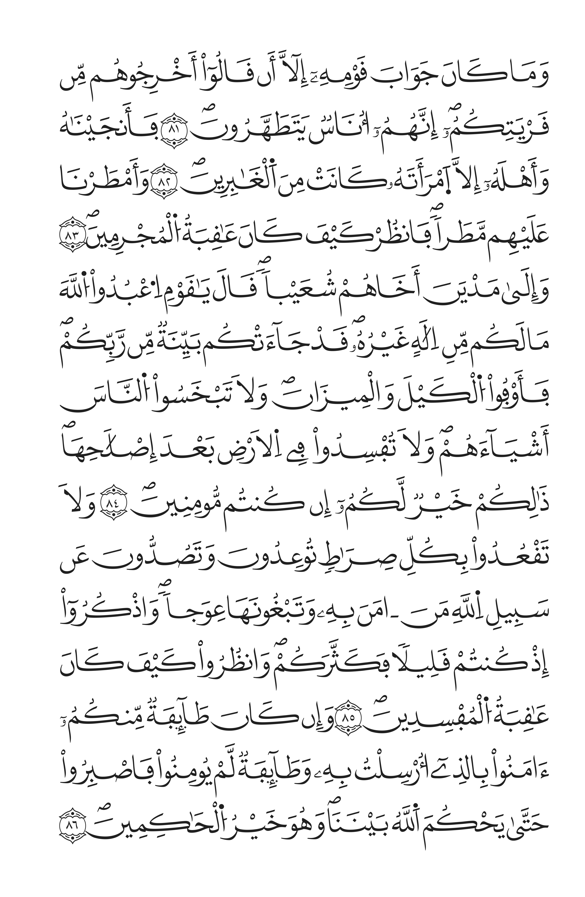

- Then, it calls [`self.processor.process`](../backend/core/page_detection/pipeline.py#135), and for each page, it does the following:

- `process` method calls [`detect`](../backend/core/page_detection/page_processor.py#115) method.

- Inside the `detect` method, it makes sure that it is operating inside the content box of the page after using the bounds and the alternate_margins to determine the correct content box for the page.


- Then, it tightens the page to its content box,


- Detects the bands:

  There are two types of bands: sura header bands and text bands.

  Before detecting the text bands, it finds the sura header bands first.

  The sura header bands is detected as follows:

  - It scans the entire page with the sura_header tempalte using the `cv2.matchTemplate` method, and get the scores for each area it covers.

  - It filters the areas that have a score above the `header_threshold`.

  - Sorts the found areas by their score in descending order.

  - Then, it iterates over the found areas, and append the area to the list of found bands if it does not overlap with any of the already found bands. This is done to avoid duplicate detections of the same sura header and avoid same band positions (the band can gets accepted scores above and below itself by few rows, these are discarded in this loop).

  - It sorts the found bands by their y coordinate in ascending order.

  - The sura_header bands are stored in the context `ctx` in `sura_headers`.

    The text bands is detected as follows:

  - It finds the areas that are not reserved for the sura header bands, and considers them as text bands if they are above the minimum height of a text band (which is the height of a line multiplied by the number of lines per page).

  - It validates the overall height to make sure it doesn't pass the height of the page.

  After detecting the bands, it starts to iterate over the found bands, and for each band, it starts to detect the lines and split it as follows:

  - Calculates the sum of the pixels in each row of the band.

  - The result can be interpolated as a 1D signal, and the local minima of this signal are the lines' separators.
  

  - The resulted plot can look like a very rough signal, so it is smoothed using

    ```python
    def _smooth(profile: np.ndarray, kernel_size: int) -> np.ndarray:
        """Apply a small moving-average to reduce single-row noise."""
        kernel = np.ones(kernel_size) / kernel_size
        return np.convolve(profile, kernel, mode="same")
    ```

    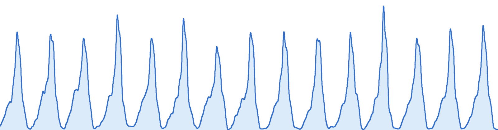

  - The local minima are detected using differentiation:

    ```python
    def _find_local_minima(profile: np.ndarray) -> list[int]:
        """Return indices of all local minima (strict descent then ascent)."""
        diff = np.diff(profile)
        # A minimum at i means: diff[i-1] <= 0 (descending/flat) AND
        # diff[i] >= 0 (ascending/flat), with at least one strict inequality.
        descending = diff[:-1] <= 0
        ascending = diff[1:] >= 0
        strict = (diff[:-1] < 0) | (diff[1:] > 0)
        mask = descending & ascending & strict
        # Offset by 1 because diff shifts indices
        return (np.where(mask)[0] + 1).tolist()  # type: ignore[no-any-return]
    ```

  - Calcluates the topographic prominence. For every candidate valley, the engine measures how deep it is relative to the surrounding peaks. A deep, well-defined valley is a stronger candidate for a line boundary than a shallow dip caused by ink variation inside a line.

  - Then, it sorts these local minima by their prominence in descending order, and keeps the top `Lines/Page - 1` local minima that doesn't overlap as the lines separators.
    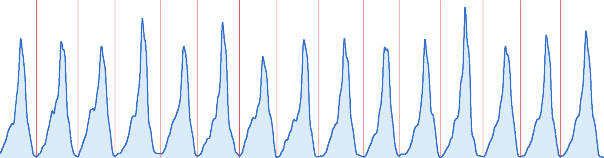

  - Finally, it maps the valleys back to original coordinates.

  After detection is done, all the found lines and headers are stored in the context `ctx` in `lines` where sura-header bands are stored as `LineResult` objects marked with `is_sura=True`; the export layer later represents them as `type="sura_header"`.

The engine then validates the number of found lines and headers to make sure they are exactly the number of lines per page (considering the header slots).

It then iterates over the found lines, and splits each line into segments (splits the line by the aya_separator) as follows:

- It cicks from [`self.aya_separator.split_segments(ctx)`](../backend/core/page_detection/page_processor.py#L181).

- If the line is a sura_header, skip it.

- Tightens the line to remove any extra whitespace around it. And if it results in an empty line, skip it.

- For a line whose content does not fill the full line box, separator detection is restricted to its trimmed content region. And if the trimmed content region is empty, skip it.

- Locate the aya_separator with the aya_separator template using `cv2.templateMatch()`. The flow is much the same as that of sura_header, finds the template mositions with scores, filter them by the `aya_threshold`, sort them by score, and filter the overlapping ones.


- Then, it splits the line into segments by the found aya_separator positions, and store them in the context `ctx` in `segments` under the line's index.

- Each segment is marked if it contains a separator or not for future use.

Then, comes the tracker, which is responsible for numbering the swar and the ayat after detection the coordinates. It is initialized by the provided aya (sura, aya) from which the pages' range start.

- It iterates over the lines, if the line is a sura_header, it increments the sura number and resets the aya number to 1. Of course there are some edge cases that are handled, such as we started from a sura header, and of course we specified the starting sura to be this one, and the aya to be 1.

- If the line is a text that doesn't contain a separator and comes directly after a sura_header, it is considered to be a basmala.

- Else, it is a normal text line, so it interates over its segments. This condition handles surat Al-tawbah correctly. Assigning the current aya number to the first segment, if the segment contians a separator, it increments the aya number and assigns it to the next segment, and so on.

Finally, the engine exports its results whether to the backend api or to a terminal or to an output file.

## Word Engine

### Requirements

1. The mushaf should be processed by the line engine first. And it is preferred to finish the lines step of the line engine before starting the word engine, but it is not required.

2. Process only one page at a time, until you reach a satisfying accuracy. Then, you can process the rest of the pages in batch. This is not required, but it is preferred to avoid wasting time in case the accuracy is not satisfying.

### Flow

I will take the first page as an example, then the second page that will have some extra steps in which it make use of the results from the first page, and the rest of the pages will follow the same pattern.

You press "Process page 1" button, sending a request which will be handled by the following view:

```python
@router.post("/{mushaf_id}/pages/{page_number}/calibration/process", response={202: ProcessOut})
def process_calibration(request: HttpRequest, mushaf_id: uuid.UUID, page_number: int) -> tuple[int, dict]:
    """Process one page for review; returns at once with the job to poll."""
    user = current_user(request)
    mushaf = mushaf_service.get_mushaf(mushaf_id, user=user)
    job = calibration_service.start_page(mushaf, page_number, user=user)
    return 202, {"job": jobs_service.to_dict(job)}
```

`mushaf = mushaf_service.get_mushaf(mushaf_id, user=user)` get the mushaf object if it is in the database and the user is authorized to write to it (unlike published mushafs that the users can read it only).

`job = calibration_service.start_page(mushaf, page_number, user=user)` Process the page for review, as a background job. It returns this job object to the user to poll it until it is done. The job object contains the job id, status, and progress.

In `start_page` method,

- `start, end = _span_for_page(mushaf, page)`: This method returns the start and end aya for the page. The start aya may start from the previous page, and the end aya may end in the next page. The engine will use the segments of the other pages as context for the current page, and they will be read-only.  
For page 1, `start = (1, 1)` and `end = (1, 7)`. Where `(sura_id, aya_id)` is the format of the tuple.

- `plan = word_runs.preflight(mushaf, start, end)`: This method checks everything checkable while the caller can still be told. This reduces the chance of wasting time on a page that is not processable.  
Inside the `preflight` method, it checks the following:

  - It gets the counting system of this mushaf, for example, for this mushaf, it is `kufi`. Else, it return an error.
  - Then it finds the first line that holds the span's first aya (`1:1`) and the last line that holds its last aya (`1:7`). They may be on the previous or next page. Only text lines are considered, so the sura header (line 1 of this page) is never picked. For our example they are `LINE 2` and `LINE 8`.

  - Finally it returns a run plan object, for our example, it is `RunPlan(start=(1,1), end=(1,7), total_lines=7, first_page=1, last_page=1)`.

  - Again, during the preflight, it makes sure that every error that might happen is caught and reported to the user, so the user can fix it before starting the background job.

Then, comes

```python
review = _review(mushaf, page)
    if (
        review is not None
        and review.payload.get("lines")
        and _sources_current(mushaf, review.payload["lines"])
        and _context_current(mushaf, review.payload.get("context", []))
    ):
        _refuse("already_processed", page=page)
    expected = review.revision if review else 0
```

Since we didn't process any pages before, `review` is None, and `expected = 0`.

Then, `run` method is defined,

```python
def run(job: ProcessJob) -> None:
        done = process_page(
            mushaf,
            page,
            expected_revision=expected,
            user=user,
            progress=lambda count: jobs._touch(job.id, phase="detecting", lines_done=count),
            cancelled=lambda: jobs.cancel_requested(job.id),
        )
        jobs.settle(
            job.id,
            ProcessJobStateChoices.COMPLETED if done else ProcessJobStateChoices.CANCELLED,
            pages_saved=1 if done else 0,
        )
```

Then, we come to the end of the `start_page` method, and it returns the job object to the user to poll it until it is done.

```python
    return jobs.start_words(
        mushaf,
        plan,
        user=user,
        runner=run,
        inline=inline,
        kind=ProcessJobKindChoices.CALIBRATION,
        current_page=page,
    )
```

`start_words` method takes it from here, and it starts the background job, and returns the job object to the user to poll it until it is done.

Inside the `start_words` method,

- `ensure_idle(mushaf.id)`: This method makes sure that there is no other job running for this mushaf, and if there is, it returns an error to the user.

- `_ensure_capacity(user)`: This one makes sure that the user is within the limits (of jobs) of the server.

- The Job object is created,

```python
job = ProcessJob.objects.create(
        kind=kind,
        mushaf=mushaf,
        started_by=user,
        page_range_start=plan.first_page,
        page_range_end=plan.last_page,
        current_page=current_page,
        total=plan.total_lines,
        lines_done=0,
        start_sura=plan.start[0],
        start_aya=plan.start[1],
        end_sura=plan.end[0],
        end_aya=plan.end[1],
        heartbeat_at=timezone.now(),
    )
```

For our example, it will be:

```python
ProcessJob(
    kind=calibration,
    state=running,
    phase=starting,
    page_range_start=1,
    page_range_end=1,
    current_page=1,
    total=7,
    lines_done=0,
    pages_saved=0,
    start_sura=1,
    end_sura=1,
    start_aya=1,
    end_aya=7,
    started_at=now,
    heartbeat_at=now
)
```

Then, `return _launch(job, runner, inline)`. `_launch` method takes it from here, and it starts the thread that will be running in the background, or it will run `runner` inline in the same thread. It will use the method `_execute` to run the `runner` either way. And for our example, `inline=False`, so `_execute` will be called from the new thread.

At this point, the user will get its response. And after that the frontend will start polling the job object checking its status and progress, until it is done. And the user will be notified when it is done.

`_execute` function is the wrapper for the `runner` function, which is the `run` function defined in the `start_page` method. It will catch any exception that might happen during the execution of the `runner` function, and it will set the job state as appropriate, log any errors, and close the database connection of the thread.

```python
def _execute(job: ProcessJob, work: Callable[[ProcessJob], None], *, threaded: bool) -> None:
    """Run ``work``, and make sure the job settles whatever happens."""
    try:
        work(job)
    except Exception as exc:  # a job must never take the server down
        logger.exception("Processing job %s failed", job.id)
        settle(job.id, ProcessJobStateChoices.ERROR, error=str(exc) or exc.__class__.__name__)
    else:
        current = ProcessJob.objects.filter(pk=job.pk).values_list("state", flat=True).first()
        if current is not None and current not in TERMINAL_STATES:
            # `work` returned without settling the job — treat as an error rather
            # than leaving a poller waiting forever.
            settle(job.id, ProcessJobStateChoices.ERROR, error="Processing ended without a result.")
    finally:
        if threaded:
            # Each thread gets its own DB connection; without this the handle
            # stays open for the life of the (daemon) thread.
            connections.close_all()
```

Back to the `run` function, it calls `process_page` method, then `jobs.settle`. `jobs.settle` method is responsible for setting the job state as completed or cancelled, and it will also set the number of pages saved. For our example, it will be `pages_saved=1` since we processed one page.

The `process_page` method does the following:

- It starts with `start, end = _span_for_page(mushaf, page)`, same as before, it returns the start and end aya for the page. For our example, it is `start = (1, 1)` and `end = (1, 7)`.
- It gets the counting system for the mushaf. `system = word_inputs.counting_system_for(mushaf)`.
- It gets the word stream of this page span for this counting system, `stream = words_service.word_stream(system, start=start, end=end)`. The word stream is a list of `WordInput` objects that contains the text of the word, its paws (parts of a word: how many separate ink pieces its letters make), and its i'jam (how many groups of dots it has above and below the writing line).  
For our example, it will be:

```python
[
    WordInput(text='بِسْمِ', paws=1, ijam_above=0, ijam_below=1, aya='1:1', id=1, short_weight=20),
    WordInput(text='ٱللَّهِ', paws=2, ijam_above=0, ijam_below=0, aya='1:1', id=2, short_weight=20),
    WordInput(text='ٱلرَّحْمَٰنِ', paws=3, ijam_above=1, ijam_below=0, aya='1:1', id=3, short_weight=20),
    WordInput(text='ٱلرَّحِيمِ', paws=3, ijam_above=0, ijam_below=1, aya='1:1', id=4, short_weight=20),
    WordInput(text='ٱلْحَمْدُ', paws=2, ijam_above=0, ijam_below=0, aya='1:2', id=5, short_weight=20),
    WordInput(text='لِلَّهِ', paws=1, ijam_above=0, ijam_below=0, aya='1:2', id=6, short_weight=20),
    WordInput(text='رَبِّ', paws=2, ijam_above=0, ijam_below=1, aya='1:2', id=7, short_weight=20),
    ...
]
```

- Then, we get the lines for the page span, `lines = _span_lines(mushaf, start, end)`. Which contains the text lines that hold the span's ayat: the page's own text lines, plus any lines from the previous or next page if the page's first aya starts there or its last aya ends there. For our example, it is the 7 text lines of page 1 (lines 2 to 8, since the sura header is not a text line).

- After that, we get the profile and library for the mushaf and page, `profile, library = profile_for(mushaf, page)`. Since we didn't process any pages before, it will create a new profile for this mushaf and returns an empty library.

> **Profile** is a snapshot of the settings used plus the approved pages used, kept so any past result can be reproduced.

For this page, it will be:

```python
CalibrationProfile(
    mushaf=mushaf,
    signature='3fc2e35fd47f770354a1176be661997710a12d1f100a5ec3637fcf846d9790e6',
    payload={
        'limit': 0.27,
        'pages': [],
        'library': 1,
        'revisions': [],
        'comparison': 'descriptor32',
        'feature_version': 1
    },
    mode="shadow",
)
```

- Then, `templates = snapshots.Templates.of(mushaf)`, and as it indicates, it gets the templates of the mushaf, which are the aya_separator (ornament) as an Image and npArray, and symbols which are the sajda symbol and rub_hizb symbol if they exist in the mushaf as npArrays.

- Then, `approved = _approved_rows(mushaf, {line.page.page_number for line in lines} - {page})`, this line uses lines we got from `_span_lines` method, and it gets the approved rows of the pages that are part of the span but not the current page (the ones we called context, it gets the approved ones from the context).  
For our example, it will be an empty dictionary (`{}`): every line of the span is on page 1, so there are no other pages to look at.

- Then, `earlier = _review(mushaf, page)`, this line gets the previous review of the current page, if it exists. Which is not the case for our example, so it will be None.

- Finally, `before = {row["snapshot_id"]: row for row in (earlier.payload.get("lines", []) if earlier else [])}`, this line builds a lookup table called `before` in which the key is the snapshot_id of the row, and the value is the row (line) itself. For our example, it will be an empty dictionary since we didn't process any pages before.

- Now, the preparations of the page are done. The method starts by iterating over the lines of the page, and for each line, it does the following:

  - **Cancel check**. If you pressed cancel, it stops and process_page returns False, with nothing stored.
  - **Render the PDF page once**. The first time a page is seen, it is rendered to an image and kept in `rendered`. The other lines on that page reuse it.
  - Get the line’s snapshot. `snapshot_line` reuses an existing snapshot if the line’s sources are unchanged. Otherwise it measures the ink and stores a new one.

  ```python
    def snapshot_line(
        mushaf: Mushaf, line: Line, rendered_page: Image.Image | None = None, templates: Templates | None = None
    ) -> CalibrationSnapshot:
        """The line's snapshot, measured now only if its sources changed since the last.

        Idempotent per fingerprint: the same sources always return the same row, so the
        blob ids a reviewer labelled stay the ids the next preview sees.
        """
        fingerprint = source_fingerprint(line)
        existing = CalibrationSnapshot.objects.filter(mushaf=mushaf, fingerprint=fingerprint).first()
        if existing:
            return existing
        if rendered_page is None:
            rendered_page = line_images._render_page(mushaf, line.page)
        extraction = extract_line(line, rendered_page, templates or Templates.of(mushaf))
        snapshot = CalibrationSnapshot(
            mushaf=mushaf,
            page_number=line.page.page_number,
            line_number=line.line_number,
            source_line_id=line.id,
            fingerprint=fingerprint,
            metadata={**extraction.metadata, "source_fingerprint": fingerprint},
        )
        snapshot.image.save("image.png", ContentFile(png_bytes(extraction.image)), save=False)
        snapshot.labels.save("labels.png", ContentFile(png_bytes(encode_labels(extraction.raster))), save=False)
        snapshot.save()
        return snapshot
    ```

  The first line calculates the fingerprint of the line, which is a hash of all the data that changing it would affect the measured blobs.
  This fingerprint is then used to get the snapshot of the line from the database if it exists. Which is not the case in our example.
  Thus, it is measured by `extract_line` method. This method does the following:
  - Cut the line out of the page, `image, origin = line_images._image_for(line, rendered_page, None)`. The line is cut at its own box (586 × 106 px for this line), and `origin` is the page x of the image's left edge (730 here). The paper of this mushaf is tinted, which is why the background in the image below is not white.
    
  - Where the ornament (aya_separator) sits, `spans, ayat = line_images._separators(line, origin, image.width, template_width)`. `spans` is a list of tuples of the start and end x coordinates of the separators, and `ayat` is a list of the aya numbers of the separators.
  - Wrap it for the measurer, `source = LineImage(image, label, str(line.id), spans, ayat)`. `LineImage` is a frozen container: image, a label for reports (`page-0001/line-02`), a source id, and the ornament spans and the ayat they close, which are already known.
  - Measure the ink: `analyse_line`. This is the core of the word engine.

    1. It converts the line image to a binary image (an ink mask), where the ink is `True` and the background is `False`. An image with transparent pixels uses its alpha for this. One without, like this tinted one, uses an Otsu threshold on its grey version.
    
    2. It calculates where the ink starts for both directions, vertically and horizontally, and calls them offsets.
    3. It tightens the image to remove any extra whitespace around ink. For this line it trims 6 px from the left, 5 from the top, 5 from the right and 3 from the bottom (the red box), so `offset_x = 6` and `offset_y = 5`.
    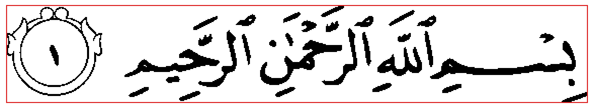
    4. It finds the densest row of the line, and calls it `peak` and is considered as the writing baseline.
    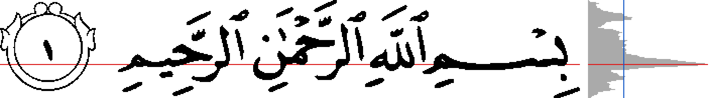
    The red line is the peak row (row 64 of the tightened image). The bars on the right are the ink counts, one bar per row, and the red bar is the peak. The blue vertical line marks 30% of the peak, used in the next step.
    5. The floor is 30% of the peak row's ink count. It moves up from the peak while the next row up still holds at least the floor, and the last row that does is `top`. It does the same downward for `bottom`. For this line, the band is rows 48 to 69.
    6. The area between `top` and `bottom` is called baseline band.
    
    7. It finds the connected components using `cv2.connectedComponentsWithStats` method, and for each component, it gets:
    - `count`: The number of labels, including the background (label 0). For this line it is 34, for 33 components.
    - `label_map`: A 2D array of the same size as the tightened image (98 × 575 here), where each pixel holds the label of the component it belongs to, and 0 for the background. For example, this is a small piece of line 2 around the word ٱللَّهِ, at half resolution (each cell is 2 × 2 pixels, the most frequent label in it), with the empty rows between the marks removed:

    ```text
    .  .  .  .  .  .  .  .  .  .  .  .  .  .  .  .  .  .  3  3  .  .  .  .
    .  .  .  .  .  .  .  .  .  .  .  .  .  .  .  .  3  3  3  3  .  .  .  .
    .  .  .  .  .  .  .  .  .  .  .  .  .  .  3  3  3  3  3  3  .  .  .  .
    .  .  .  .  .  .  .  .  .  .  .  .  3  3  3  3  3  3  .  .  .  .  .  .
    .  .  .  .  .  .  .  .  .  .  .  3  3  3  3  3  .  .  .  .  .  .  .  .
    .  .  .  .  .  .  .  .  .  3  3  3  3  3  3  .  .  .  .  .  .  .  .  .
    .  .  .  .  .  .  .  .  3  3  3  3  3  .  .  .  .  .  .  .  .  .  8  8
    .  .  .  .  .  .  .  3  3  3  3  .  .  .  .  .  .  .  .  .  .  8  8  8
    .  .  .  .  .  .  .  3  3  .  .  .  .  .  .  .  .  .  .  .  .  8  8  8
                                        ·· gap ··
    .  .  .  .  .  .  .  .  .  .  .  .  .  . 18 18 18 18  .  .  .  .  .  .
    .  .  .  .  .  .  .  .  .  .  .  . 18 18 18 18 18 18  .  .  .  .  .  .
    .  .  .  .  .  .  .  .  .  .  . 18 18 18 18 18 18 18  .  .  .  .  .  .
    .  .  .  .  .  .  .  .  .  .  . 18 18 18 18 18 18  .  .  .  .  .  .  .
    .  .  .  .  .  .  .  .  .  .  .  . 18 18 18  .  .  .  .  .  .  .  .  .
                                        ·· gap ··
    .  .  .  .  .  .  .  .  .  .  .  .  .  . 24 24  .  .  . 24 24  .  .  .
    .  .  .  .  .  .  .  .  .  .  .  .  .  . 24 24  .  .  . 24 24 24  .  .
    .  .  .  .  .  .  .  .  . 24  .  .  .  . 24 24 24  .  . 24 24 24  .  .
    .  .  .  .  .  .  .  . 24 24  .  .  .  . 24 24 24  .  . 24 24 24  .  .
    .  .  .  .  .  .  . 24 24 24  .  .  .  .  . 24 24  .  .  . 24 24 24  .
    .  .  .  .  . 24 24 24 24 24  .  .  .  .  . 24 24  .  .  . 24 24 24  .
    .  .  .  . 24 24 24 24 24 24  .  .  .  .  . 24 24 24  .  . 24 24 24 24
    .  .  . 24 24 24 24 24 24 24  .  .  .  .  . 24 24 24 24  .  . 24 24 24
    .  . 24 24 24 24 24 24 24 24 24  .  .  .  . 24 24 24 24 24  . 24 24 24
    . 24 24 24 24 24 24 24 24 24 24  .  .  . 24 24 24 24 24 24 24 24 24 24
    . 24 24 24 24 24 24 24 24 24 24 24 24 24 24 24 24 24 24 24 24 24 24 24
    . 24 24 24 24 24 24  .  . 24 24 24 24 24 24 24  . 24 24 24 24 24 24  .
    .  .  .  .  .  .  .  .  . 24 24 24 24 24 24 24  .  .  .  .  .  .  .  .
    .  .  .  .  .  .  .  .  .  .  . 24 24 24  .  .  .  .  .  .  .  .  .  .
                                        ·· gap ··
    .  .  .  . 28 28 28 28 28  .  .  .  .  .  .  .  .  .  .  .  .  .  .  .
    . 28 28 28 28 28 28 28 28  .  .  .  .  .  .  .  .  .  .  .  .  .  .  .
    28 28 28 28 28 28 28 28  .  .  .  .  .  .  .  .  .  .  .  .  .  .  .  .
    28 28 28 28 28 28  .  .  .  .  .  .  .  .  .  .  .  .  .  .  .  .  .  .
    28 28 28  .  .  .  .  .  .  .  .  .  .  .  .  .  .  .  .  .  .  .  .  .
    ```

    This example shows several components: the letters "لله" of the word ٱللَّهِ are one component with id 24 (its alif is a separate thin stroke, id 14, just to the right of this crop), the shadda is id 18, the fatha is id 3, the kasra is id 28, and id 8 belongs to the neighbouring part of the line. The background is always 0, shown as '.' for clarity.
    - `stats`: is an array with one row per label, so row `k` describes label `k` (row 0 is the background). Each row has 5 values: x, y, w, h, and area. Where (x, y) is the top-left corner of the component, (w, h) is the width and height of the component, and area is the number of pixels (ink) in the component.
    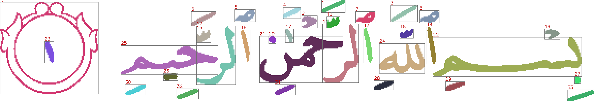

    8. It iterates over the components and create a `Blob` object for each, storing the x, y, w, h, area, label, and `preferred` value which is one of three values:
    - `body`: If the component crosses the baseline row (peak).
    - `mark`: If it crosses the baseline band but not the baseline row.
    - `mark-only`: If it floats above the baseline band or below it.
    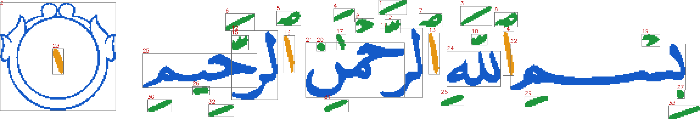
    9. Before scoring, it finds which components are *nested*: a component whose box lies wholly inside the box of a much larger one (its area is under 35% of the larger one's, `NESTED_AREA_FRACTION`). Small marks sitting in the sweep of a letter, or the digit inside the aya ornament, are the usual cases. The larger component can be any component, not only a body.

    ```python
    nested = {
        small.label
        for small in components
        for big in components
        if small is not big
        and big.x <= small.x
        and small.right <= big.right
        and big.y <= small.y
        and small.bottom <= big.bottom
        and small.area < NESTED_AREA_FRACTION * big.area
    }
    ```

    For this line they are blobs 15, 20 and 23, shown in red.
    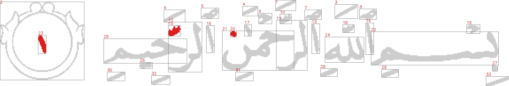
    10. Another loop over the components to give each one a score based on some criteria,

    ```python
    for blob in components:
        overlap = max(0, min(blob.bottom, bottom + 1) - max(blob.y, top))
        blob.small_for_body = blob.preferred != "body" and blob.area < smallest_crossing
        blob.nested_in_a_body = blob.label in nested
        blob.body_score = max(
            0,
            round(
                SCORE_CROSSES_WRITING_LINE * (1.0 if blob.preferred == "body" else 0.0)
                # Against the band's height, not the blob's: see SCORE_BAND_OVERLAP.
                + SCORE_BAND_OVERLAP * min(1.0, overlap / band_height)
                + SCORE_RELATIVE_AREA * min(1.0, blob.area / max(1.0, typical_area))
                + SCORE_RELATIVE_HEIGHT * min(1.0, blob.h / band_height)
                - SCORE_NESTED_IN_A_BODY * (1.0 if blob.nested_in_a_body else 0.0)
            ),
        )
    ```

    - If the component crosses the baseline row (its `preferred` is `body`), it gets the whole `SCORE_CROSSES_WRITING_LINE`. Otherwise this term is 0.
    - It gets `SCORE_BAND_OVERLAP` multiplied by how much of the band's height it covers (`overlap / band_height`, at most 1).
    - It gets `SCORE_RELATIVE_AREA` multiplied by `blob.area / typical_area`, at most 1. The typical area is the median area of the components whose `preferred` is `body`. A component as big as a typical body, or bigger, gets all of it, and a smaller one gets a share.
    - It gets `SCORE_RELATIVE_HEIGHT` multiplied by `blob.h / band_height`, at most 1.
    - If the component is nested (see above), it loses `SCORE_NESTED_IN_A_BODY`. The total is rounded and never goes below 0.
    > SCORE_CROSSES_WRITING_LINE = 6, SCORE_BAND_OVERLAP = 3, SCORE_RELATIVE_AREA = 3, SCORE_RELATIVE_HEIGHT = 2, SCORE_NESTED_IN_A_BODY = 4
    > These values reflect the weight of each criteria, and they are used to calculate the final score of the component. The final score is the sum of the terms above (minus the nested penalty), rounded, and it is a whole number from 0 to 14.

    Example, blob 14 of this line (a thin vertical stroke, 9 × 36 px, area 148): it does not cross the peak row, so that term is 0. It covers 14 of the band's 22 rows, so `3 × 0.64 = 1.9`. Its area against the typical body area (780) is `148 / 780 = 0.19`, so `3 × 0.19 = 0.57`. Its height is 36 against the band's 22, which caps at 1, so `2 × 1 = 2`. It is not nested. The sum is 4.47, rounded to **4**. Blob 22 (the first word, بسم) gets the full 14, and the tiny blob 20, which is nested, gets 0.

    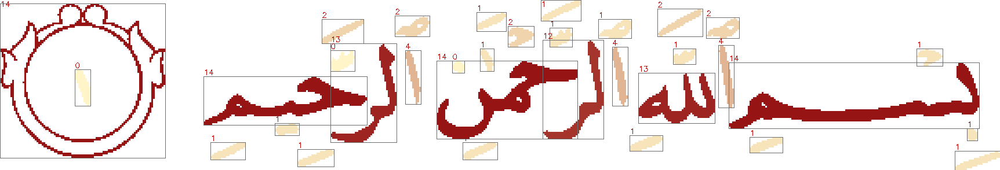

    11. The components are then sorted by their position from right to left.
    12. Bodies are combined in a dedicated list and marks are combined in another list.
    13. All of these data are combined in a `LineInk` object and returned to the caller.

  - After `analise_line` returns, `split_symbols` function takes non-word symbols out of the ink — a sajda marker, a rub' rosette.
  - Then, `split_separators`, this one excludes the separators (ornaments) and any blobs inside it from the ink bodies or marks and create a dedicated list for the ornament-related blobs, and it specifies which body blobs lies before each ornament, so that it is known which body blob belong to which aya.
  - Then, all the data are combined in a dict:

  ```python
        metadata = {
            "version": EXTRACTION_VERSION,
            "bbox": {"x": origin, "y": max(0, line.bbox_y), "w": image.width, "h": image.height},
            "source": source.source,
            "label": source.label,
            "blobs": [asdict(blob) for blob in all_blobs],
            "components": [blob.label for blob in ink.components],
            "separators": [[blob.label for blob in group] for group in ink.separators],
            "symbols": [[name, [blob.label for blob in group]] for name, group in ink.symbols],
            "separator_spans": ink.separator_spans,
            "separator_ayat": ink.separator_ayat,
            "symbol_spans": ink.symbol_spans,
            "band": list(ink.band),
            "peak": ink.peak,
            "offset_x": ink.offset_x,
            "offset_y": ink.offset_y,
            "segments": list(
                line.segments.order_by("segment_order").values(
                    "bbox_x", "bbox_w", "aya_number", "has_separator", "segment_order"
                )
            ),
            "sura": line.sura_id,
        }
    ```

    and passed as an argument to instantiate an `Extraction` object which is then returned to the caller. `return Extraction(image=image, raster=raster, metadata=metadata, ink=ink)`.
    The `Extraction` object contains the image of the line, the 2D array of labels, the metadata dict above, and the `ink` object.

    - All of these data is stored inside an instance (a row in the database) of `CalibrationSnapshot` model, which is then returned to the caller.

    ```python
        snapshot = CalibrationSnapshot(
            mushaf=mushaf,
            page_number=line.page.page_number,
            line_number=line.line_number,
            source_line_id=line.id,
            fingerprint=fingerprint,
            metadata={**extraction.metadata, "source_fingerprint": fingerprint},
        )
        snapshot.image.save("image.png", ContentFile(png_bytes(extraction.image)), save=False)
        snapshot.labels.save("labels.png", ContentFile(png_bytes(encode_labels(extraction.raster))), save=False)
        snapshot.save()
    ```

    > Note that the image is also saved in the snapshot, and the labels are saved also as an image not an ndarray.

    

    - Next, we get to `row = _blank_row(snapshot, line, library, readonly=readonly)`, `_blank_row` copies a line’s stored measurements into the draft’s row format: every blob moves into page coordinates with a first-guess role (body, mark, ornament or symbol). All the decision fields start empty, and the line has no words yet. If the library can already tell bodies from marks, it also attaches its suggestion to each blob. The row is the starting state that the alignment and the reviewer then fill in.

    - Now, we processed all the lines of the page, and prepared all the required data and made an intial guess of each line's blobs roles. All these data is put inside `document` dict,

    ```python
        document: Doc = {
            "page": page,
            "start": list(start), # starting aya
            "end": list(end),  # ending aya
            "stream": [asdict(word) for word in stream],  # the words' text of this page
            "profile": _profile_summary(profile, library),  # the profile and library of this mushaf
            "lines": [row for row in rows if not row["readonly"]],  # the lines of this page as we processed them inside the previous loop
            "context": [row for row in rows if row["readonly"]],  # the lines of the other pages (the context).
            "issues": [],
        }
    ```

#### Alignment: giving every word its ink

At this point, every blob has a first-guess role (body or mark), but no blob belongs to any word, and no line has any words. Alignment fills that gap. It is one call:

```python
document = align_document(mushaf, document, text_locks=False)
```

**The idea.** Arabic spelling says exactly how many separate pieces (PAWs) each word makes, and the text gives us that number (`paws` in the word stream). The image gives the same number by measurement: the blobs that are letter bodies. So matching words to ink is counting, not recognition. A blob that is a *body* spends one PAW of the word it belongs to. A blob that is a *mark* (a dot, a fatha, ...) spends none. The only question is *which blobs are the bodies*, and the answer is the combination that makes the counts match at the lowest price.

Take the toy case: word W1 wants 2 pieces, word W2 wants 1, and the ink (right to left) is `a`, `b`, `c` where `a` and `c` are clearly letters and `b` is a thin stroke that looks more like a mark.

| reading | cost of `a` | cost of `b` | cost of `c` | words short of their count | total |
| --- | --- | --- | --- | --- | --- |
| `b` is a mark | 0 | 4 | 0 | 1 word is one piece short: 20 | 24 |
| `b` is a body | 0 | 10 | 0 | none | **10** |

The second reading wins, even though `b` *looks* like a mark. This is exactly what happens to the alef of ٱللَّهِ below.

**Flags of this call.** `align_document` has three switches, and for page 1 all three are off:

- `calibration_locks=False`: the library is empty, so there is nothing to price the blobs with. Only the first-guess scores speak.
- `affected_ayas=None`: no scope. Read the whole page and take everything the reading says. (A preview, after you edit a blob, passes the ayat you touched, and then only those take the new reading.)
- `text_locks=False`: do not add what the text itself says about the ink (small waw and ya). This first reading is the engine on its own. It is kept as the *prediction record*, so later we can measure how good the engine is by itself.

`align_document` is only a wrapper. It calls `_read` once, and calls it a second time only when the text locks moved something. The work is in `_read`, which has three phases:

```text
_read
 ├─ A. prepare     load every line's ink · carry decisions onto it · build the word list
 ├─ B. search      detect_prepared → parse_span: the one search over the whole span
 └─ C. write back  _apply_outcome per row · scope · issues · shortages
```

##### A. Prepare the engine's input

- `result = copy.deepcopy(document)`: `_read` returns a new document, and the one passed in is never changed.
- `rows = sorted(result["lines"] + result["context"], ...)`: the rows to read, in reading order. For page 1 these are the 7 lines (2 to 8) and no context rows. `stored` is the snapshots of those rows, in one query. The row in the document only holds *decisions*; the ink itself lives in the snapshot, so `_read` loads it again.
- `units = _fused_units(rows, stream)` finds words that a person said share one blob (printed touching), so that the engine reads them as one. There are no human decisions yet, so `units == {}`. In the same way, `weights` (what a missing PAW costs each word) are learned from confirmed pages and are only used with `calibration_locks`, so they are `{}`.
- For each row, the ink is rebuilt and filtered:

```python
image, ink = snapshots.load(stored[row["snapshot_id"]])
cut = set(snapshots.select_span(ink, stored[row["snapshot_id"]].metadata, start, end))
```

  - `snapshots.load` rebuilds the `LineInk` (blobs, bands, ornament spans) from storage, without measuring anything. It makes *fresh* `Blob` objects every time, because the engine writes roles onto them and a shared object would carry one reading into the next.
  - `select_span` keeps only the blobs that belong to the ayat `start..end`, and returns the labels of the blobs that cross the span's edge (`cut`, flagged `span-boundary` later). A blob is never split. For page 1 the whole page is inside the span, so nothing is dropped: line 2 goes from 31 blobs to 31.
  - Erased blobs would be taken out here (`_without`), and `_constrain(blob, decision, ...)` would carry each blob's decisions onto it: a human lock, a text lock, a library price, the words a person gave it. For page 1 nobody decided anything, so no blob is constrained.

| line | blobs | ornaments (aya they close) |
| --- | --- | --- |
| 2 | 31 | 1 (1:1) |
| 3 | 29 | 1 (1:2) |
| 4 | 41 | 2 (1:3, 1:4) |
| 5 | 47 | 1 (1:5) |
| 6 | 48 | 1 (1:6) |
| 7 | 32 | 0 |
| 8 | 17 | 1 (1:7) |

- The words: one `WordInput` per word of the stream (`_word(...)`; a fused unit would be one entry for several words), and then everything is packed for the engine and called:

```python
source = WordBoundaryInput(lines=images, words=stream, ijam=cast(IjamMode, mushaf.ijam_mode))
aligned = detect_prepared(source, inks)
```

**What the engine knows about a blob: two prices.** The `Blob` converts its body score into the price of each reading:

```python
cost_as_body = BODY_SCORE_MAX - body_score          # 14 - score
cost_as_mark = min(body_score, MAX_UNUSED_COMPONENT_COST)   # at most 6
```

> BODY_SCORE_MAX = 14, MAX_UNUSED_COMPONENT_COST = 6
> A high score means "this looks like a letter": cheap to read as a body, but dear to leave unused (up to 6). A low score is the opposite. The cap exists because a line often carries a stroke or two more than the text accounts for, so leaving a body-looking stroke unused has to stay cheap. When the library has examples (page 2 onward), it replaces these two prices.

For line 2:

| blob | what it is | preferred | score | cost as body | cost as mark |
| --- | --- | --- | --- | --- | --- |
| 22 | the word بسم | body | 14 | 0 | 6 |
| 24 | the letters لله | body | 13 | 1 | 6 |
| 14 | the alef of ٱللَّهِ | mark | 4 | 10 | 4 |
| 3 | the fatha | mark-only | 2 | 12 | 2 |
| 20 | a tiny nested blob | mark-only | 0 | 14 | 0 |

##### B. The search: `detect_prepared` and `parse_span`

`detect_prepared` is the engine's front door. It does five things in order:

1. `_apply_constraints`: copies constraints keyed by (line, blob label) onto the blobs and validates them. Nothing to do for page 1.
2. `parse_span(inks, words, aya_starts=...)`: **the search.** Everything below is about this one.
3. `apply_parse_roles(ink, parsed)`: writes the winning reading's role onto every blob.
4. Safety nets: the stream ran out before the lines did, the span stopped early, a hard-locked body was never placed. Each turns a line into `unresolved`/`partial` instead of reporting a plausible lie. Nothing fires on page 1 (the reading ended on word 29 of 29).
5. `_line_result`: builds one `WordLine` per line, with the word boxes.

The search is one pass over **one list of events for the whole span**, not one search per line:

1. **Events.** `_events(inks)` flattens all 7 lines into one list. Each line contributes its blobs and ornaments sorted from the right to the left, followed by a `line-end` marker. A blob event gets an `ident`, its position in the span-wide order, because a label is only unique inside its own line. For page 1 that is 245 blob events, 7 ornament events and 7 line-ends. The first line looks like this:

```text
blob 33, blob 22, blob 27, blob 19, ... , blob 30, ornament(1:1), line-end
```

2. **What the text knows.** `aya_starts` is where each aya starts in the word stream, `[0, 4, 8, 10, 13, 17, 20]` (word indexes, so word `i` has `id = i + 1`), and `aya_ends` says where each aya finishes by its label (`'1:1'` finishes after 4 words).

3. **The state.** The search keeps many possible readings alive at the same time, in a dict:

```python
states: dict[(word_index, paws_taken, previous_end, current_left), ParseRecord]
```

   The key says where a reading stands: *which word it is on and how many pieces that word has taken so far* (the last two items only decide ties by geometry). The `ParseRecord` is the best way found to get there: the total `cost`, the `groups` (which blobs each finished word took), and the blobs of the word that is still open. It starts as `{(0, 0, None, None): cost 0}`: "about to read word 0, nothing taken yet".

4. **Every blob event** (`_advance`) branches every live state in two:
   - **Leave it out as a mark** (`_with_mark`): the cost grows by `cost_as_mark`, the state is otherwise unchanged. Not allowed if the blob is locked as a body, or assigned to a word.
   - **Spend it as a body of the current word** (`_with_body`): `paws_taken` grows by the blob's `paw_count` (1). Then the word either **closes** (the state moves to the next word, and the cost grows by what the miscount costs), or stays **open** for more blobs.

```python
def _off_count(done, want, short_weight):
    if done >= want:
        return COUNT_WEIGHT * (done - want)   # 20 for each piece too many
    return short_weight * (want - done)       # 20 for each piece missing
```

   > COUNT_WEIGHT = 20, COUNT_SLACK = 2
   > A word may close having taken up to 2 pieces more or fewer than its spelling, at 20 each. It is deliberately dearer than anything an appearance judgement can cost (at most 14), so the spelling wins arguments with the ink. And it is a price, not a ban: this is what lets two letters printed touching cost one miscount instead of breaking the line.

   After each blob, paths that reached the same place are compared and only the best survives (`rank = (cost, deviations, inversions)`). Paths that are exactly equal are merged and *remembered as a tie*, not enumerated.

   This is how many readings line 2 keeps alive while it walks its 31 blobs right to left (before its ornament), and the cost of the cheapest one so far:

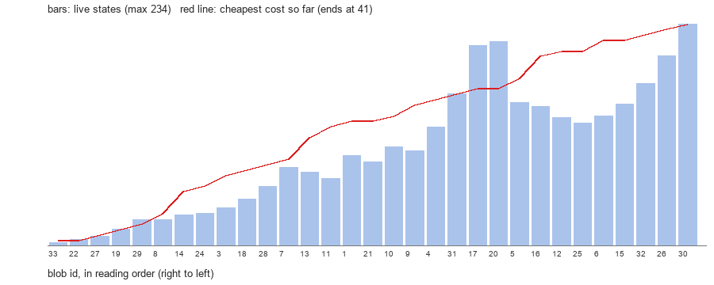

   The cheapest cost so far (41) is not the answer. A reading pays for a word's miscount only when it closes that word, so the cheapest live reading is often one that has not paid yet. A reading becomes an answer only if it closes exactly the 4 words of the aya, which is decided at the ornament, and that is where 41 becomes 59.

5. **Line end.** At a `line-end` event, `_line_end` keeps only the states with no word open: a word cannot straddle two lines. This narrows the candidates but chooses nothing. Note that the search does not stop here, an aya can continue on the next line with all its candidates still alive.

6. **Ornament: the only place the text is certain.** An ornament says an aya ends exactly here. `commit` runs:
   - `require_end = _required_end(event.aya, aya_ends, ...)`: the ornament's own label, `'1:1'`, says that aya finishes after 4 words. (If the label were missing it would count from the cursor, which is only as good as the cursor.)
   - `_settle(states, require_end)`: keep only the states that have closed *exactly* 4 words with none open, take the lowest `rank`, and if several tie, count them in `end_sequences`. Among equal ties it keeps the reading that spends the earliest ink, so a word that could sit on this line is not pushed onto the next.
   - The result is stored as a `_Commit`. Then the search **restarts from the text's position**: `entry = require_end`, `states = _fresh(entry)`. So the next aya starts where the text says, and one wrong aya cannot shift all the ayat after it.

   For aya 1:1 (words 0..4) the winning reading costs **59**:

   | | blobs | cost |
   | --- | --- | --- |
   | bodies | 22, 14, 24, 13, 11, 21, 16, 12, 25 | 0+10+1+10+2+0+10+1+0 = 34 |
   | marks | the other 22 blobs | 25 |
   | miscounts | no word is off its count | 0 |

   The other reading, leaving the three alefs (14, 13, 16) as marks, would save 6 on each (10 → 4) but then ٱللَّهِ, ٱلرَّحْمَٰنِ and ٱلرَّحِيمِ would each be a piece short, 20 each: 59 − 18 + 60 = **101**. So the engine promotes the three alefs. That is why they end up with `role: body` while their `initial_role` stays `mark`.


   The blob ids are drawn at each blob's top-left corner, so `22` sits at the left end of بسم, right next to the alef `14`.

7. **An aya can cross lines.** There is no commit at a `line-end`, only at ornaments. Aya 1:6 starts at the end of line 5 and finishes on line 6, and aya 1:7 covers lines 6, 7 and 8, as one search. This is why the aya, not the line, is the unit of search: a line that comes up a blob short can be paid for by re-reading the line above it, instead of starving a word or promoting a mark. For page 1 the search made 7 commits:

   | commit | words (index) | aya | lines | cost | equal-cost readings |
   | --- | --- | --- | --- | --- | --- |
   | 1 | 0..4 | 1:1 | 2 | 59 | 1 |
   | 2 | 4..8 | 1:2 | 3 | 47 | 1 |
   | 3 | 8..10 | 1:3 | 4 | 29 | 1 |
   | 4 | 10..13 | 1:4 | 4 | 19 | 1 |
   | 5 | 13..17 | 1:5 | 5 | 62 | 1 |
   | 6 | 17..20 | 1:6 | 5, 6 | 49 | 1 |
   | 7 | 20..29 | 1:7 | 6, 7, 8 | 126 | **2** |


8. **The tie in commit 7.** `2 equal-cost readings` means that two readings reached the same state with the same rank, so the search kept one and flagged the other. The two readings differ only in the roles of two blobs, blob 17 of line 7 and blob 7 of line 8. Both have a body score of 4, so promoting either one costs the same extra 6 (10 as a body against 4 as a mark). The engine takes the earliest ink (blob 17 on line 7) and says so: lines 6, 7 and 8 get `status = scored` with the reason `2 equal-cost readings` (the commit covers the three lines), and the two blobs are marked ambiguous so a reviewer looks at them.

9. **Packing the result.** `_to_lines` splits the commits back into one `LineParse` per line (a word never crosses a line, so every group belongs wholly to one line): the words the line holds, their blobs, and the status. A line is `exact` when nothing is wrong, otherwise `scored` with the reasons (`aya-boundary-missed`, `N word(s) off-count`, `N equal-cost readings`, `i'jam short`). A line that holds ink but no word is never `exact`: it is `unresolved`.

Back in `detect_prepared`, `apply_parse_roles` writes the roles on the blobs: a blob the winning reading used gets `body`, a blob it left out gets `mark`, and a blob nobody reached falls back to its preferred role. Then `_line_result` builds a `WordLine` per line, whose boxes come from `build_line_boxes`: each mark goes to the body it sits over (`attach_marks`), and a word's box spans its bodies *and* its marks, with the tight-crop offsets added back. For the word ٱللَّهِ on line 2:

```python
WordBox(index=1, text='ٱللَّهِ', aya='1:1', word_id=2, expected_paws=2,
        components=[14, 24], x=368, y=10, w=63, h=82, end_x=368)
```

The engine returns `WordBoundaryResult(lines=[...], words_consumed=29, complete=True)`: all 29 words were placed.

##### C. Write the answer back onto the rows

The engine answered in its own dataclasses. `_read` now writes the answer onto the draft's rows:

- `placed`: every word id the reading placed anywhere in the span. This is only needed to tell a word that moved to *another* line (it is not missing) from one that was placed nowhere. All 29 are placed.
- For each row that is not already approved, a copy is made, and `_apply_outcome(fresh, outcome, ink, cut, original, units, placed)` writes the outcome onto the copy:
  1. If the line is `unresolved` but already has words, the draft is kept and only the reason is recorded: a failed alignment is a diagnostic, never an order to erase someone's work.
  2. `owners`: blob label → word id, from each box's `components`. A mark inherits its body's owner through `attach_marks`.
  3. Every blob is updated: its `role` takes the engine's role (unless a person set it, `explicit`); its `allocations` become `[{word_id, paws}]` (1 PAW for a body, 0 for a mark); its `decision_source` becomes `human`, `calibration` or `search` (here always `search`); and its `attention` flags are recomputed from scratch by `_attention` (`uncertain`, `search-override`, `ambiguous`, `span-boundary`, ...).
  4. Every placed word becomes a dict, with its box taken from its own ink (`_edges_from_ink`) in page coordinates. Reading is right to left, so `start_x` is the *right* edge of the word and `end_x` its *left* edge.
  5. `row["status"]` and `row["reason"]` take the line's.

  The alef of ٱللَّهِ (blob 14) before and after:

```python
# before
{"id": 14, "role": "mark", "initial_role": "mark", "allocations": [], "attention": [], "decision_source": "search", ...}
# after
{"id": 14, "role": "body", "initial_role": "mark", "allocations": [{"word_id": 2, "paws": 1}], "attention": ["search-override"], "decision_source": "search", ...}
```

  `search-override` says: the search read this blob differently from what it first looked like. And a mark of the same word, blob 8, only gains its owner: `"allocations": [{"word_id": 2, "paws": 0}]`.

  The words of line 2:

```python
{"word_id": 1, "text": "بِسْمِ",       "aya": "1:1", "expected_paws": 1, "start_x": 1311, "end_x": 1155, "shared": False}
{"word_id": 2, "text": "ٱللَّهِ",      "aya": "1:1", "expected_paws": 2, "start_x": 1161, "end_x": 1098, "shared": False}
{"word_id": 3, "text": "ٱلرَّحْمَٰنِ",  "aya": "1:1", "expected_paws": 3, "start_x": 1099, "end_x": 987,  "shared": False}
{"word_id": 4, "text": "ٱلرَّحِيمِ",   "aya": "1:1", "expected_paws": 3, "start_x": 983,  "end_x": 853,  "shared": False}
```

  Word 2 starts at 1161 and ends at 1098, which is the box above (x 368 + width 63 = 431, and 431 + the line's page offset 730 = 1161).


- **Scope.** `affected_ayas is None`, so `scope = None` and every fresh row is taken whole: `row.clear(); row.update(taken)` overwrites the draft's row in place. (With a scope, `_changed_ayas` and `_within` would take the new reading only for the ayat the reviewer touched, and for the ayat their ink passes to or from, and keep the draft for the rest.)
- **Summaries.** `issues` is the set of reasons of the lines that are not `exact`: `['2 equal-cost readings']`. `_shortages` lists the ayat the reading left with fewer PAWs than their words spell, which usually means two PAWs printed touching: `[]` here, because every word got its count.

The document that comes back has the same shape as the one that went in, now with `words`, `status` and `reason` on every row and `allocations` on every blob:

| line | status | reason | words |
| --- | --- | --- | --- |
| 2 | exact | | 1, 2, 3, 4 |
| 3 | exact | | 5, 6, 7, 8 |
| 4 | exact | | 9, 10, 11, 12, 13 |
| 5 | exact | | 14, 15, 16, 17, 18 |
| 6 | scored | 2 equal-cost readings | 19, 20, 21, 22, 23 |
| 7 | scored | 2 equal-cost readings | 24, 25, 26, 27 |
| 8 | scored | 2 equal-cost readings | 28, 29 |


This was the *first* reading: no help from the text, the library or a person. But `process_page` is not done with the page yet.

#### After the first reading: the rest of `process_page`

This is what follows `align_document` in `process_page` (abridged):

```python
document = align_document(mushaf, document, text_locks=False)
alive()
prediction = _record(document, context=True)
reread = _place_text_locks(document) if _follows_text(mushaf) else set()
document["profile"]["mode"] = LEARNED
if library.examples or reread:
    document = align_document(mushaf, document, calibration_locks=True)
alive()

if _carry_decisions(document, before):
    document = align_document(mushaf, document, calibration_locks=True)
_apply_text_types(mushaf, document)
alive()
shown = _shown(document)
frozen = _frozen_record(mushaf, page, start, end, user)
```

1. **`alive()`** only reports progress: `progress(len(lines))`, which is `jobs._touch(job.id, phase="detecting", lines_done=count)`. A reading runs for seconds with no line to count, so this refreshes the job row's heartbeat. A job whose heartbeat is silent for 300 seconds (`JOB_HEARTBEAT_TIMEOUT_SECONDS`) is settled as `interrupted`, so that a crashed worker cannot hold the mushaf forever.

2. **The prediction record.** `prediction = _record(document, context=True)` is a deep copy of the document exactly as the engine alone read it (`context=True` keeps the context rows too, so the page can be read again the same way later). It is written at the end as an immutable revision, and nothing a person does afterwards can touch it. Its keys are `context`, `end`, `issues`, `lines`, `page`, `profile`, `shortages`, `start` and `stream`.

3. **What the text says about the ink: `_place_text_locks`.** The text knows things about the ink that the picture alone cannot say. The clearest case is the small waw and ya: the word لَهُۥ is spelled with a small waw after its heh. In print it sits on the writing line, so the engine, which only knows "crosses the writing line, so it is a letter", would count it as an extra piece. The text says this word has no such piece, so `_place_text_locks` finds that blob and locks it as a mark. It only runs for a mushaf that follows the Hafs text (`_follows_text`), because another riwaya spells other small letters.

   For every word whose text has a small letter, `_small_letters` takes the word's bodies from right to left, picks the body that holds the piece with that letter, and looks for the first text blob to its left that sits in the writing band, is close to it (no farther than the band's height) and is small (at most 0.4 of the line's typical body area, `SMALL_LETTER_AREA`). That blob gets `text_role="mark"`, `text_word` and `text_type` (`smallWaw` or `smallYa`). If the reading already had it as a mark of that word, it is simply finished (`_finish_text_lock`: `decision_source = "text"`, typed, and the engine's doubts about it answered). Otherwise its ayat are returned, to be read again with the lock in place.

   Page 1 has no small waw or ya, so `_place_text_locks` returns `set()`: nothing to read again.

4. **The second reading, only when there is something new to say.** `if library.examples or reread:` runs `align_document(..., calibration_locks=True)`, which is the same alignment with the library's prices and the text's locks (`text_locks` is on by default). On page 1 both are empty (the library has 0 examples and nothing moved), so there is no second reading: the draft is the first reading. `document["profile"]["mode"] = LEARNED` is set either way, and it only says "this draft was read with the library's answers priced in", which for an empty library is the same as not at all. The second reading is explained on page 2, where it happens.

5. **`_carry_decisions(document, before)`** puts an earlier draft's decisions back on the lines that did not change. `before` is `{}` on a first run, so it returns `False` and nothing happens. It is explained at the end, where a page is processed again.

6. **How the marks get their types: `_apply_text_types`.** So far a mark is only "a blob with the role mark". The editor also wants to know *which* mark it is: fatha, kasra, shadda, sukun, a dot... The first source of types is the text again, because it names every mark of every word, letter by letter.

   ```python
   def _apply_text_types(mushaf, document):
       if not _follows_text(mushaf):
           return
       rows = [row for row in document["lines"] if not row.get("readonly")]
       stored, marks = _page_marks(mushaf, rows)
       index = _library(mushaf, document["page"]).with_typed(_typed_samples(stored, rows))
       checks = text_marks.check_rows(rows, document["stream"], marks, index, ijam=mushaf.ijam_mode != "ignore")
       text_marks.apply_text_types(rows, checks)
   ```

   - `_page_marks` lists every mark of the page's rows (role `mark`, not erased) with its descriptor: the 32 × 32 picture of the blob and six geometry numbers, computed from the snapshot's labels image.
   - `index` is the library plus this page's own typed marks. On page 1 there is nothing in it.
   - `check_rows` calls `check_word` for every word that has a box. It does for the marks what the alignment did for the letters, a forced alignment between what the text says and what the ink has:

     1. **What the text expects.** `text_marks(word)` lists every mark the word's text names, with the letter it is on and where it is drawn (above the writing line, below it, or on it), and whether it may leave no ink of its own (optional). For ٱللَّهِ:

        | slot | letter | where | optional |
        | --- | --- | --- | --- |
        | wasla | the alef (0) | above | yes |
        | fatha | the second lam (2) | above | no |
        | shadda | the second lam (2) | above | no |
        | kasra | the heh (3) | below | no |

     2. **What was found.** The marks the reading gave the word: for word 2 of line 2 they are blobs 8, 3, 18 and 28 (they own them through their `allocations`), each with its x and its lane.
     3. **An assignment.** Each mark of ink goes to one slot, at the least total cost (solved exactly, with the Hungarian method). The cost of putting a mark in a slot is its *shape* (how unlike the slot's type it looks, from the library's scores; with no examples a flat 0.15), plus its *position* (0.6 × its distance from the slot's letter, as a share of the word's width), plus its *lane* (0 in the same lane, 0.25 on the writing line against above or below, never above against below). A required slot left empty costs 0.5, and so does a mark with no slot (0.1 for a pause sign).
     4. **Clean or not.** A word is *clean* when no required mark is missing, no ink is left over and no typed mark disagrees. Only the marks of a clean word get a *sure* type, and only if the library's shapes do not prefer another type by much (`_agrees`; with no examples it cannot).

   - `apply_text_types` then types every mark that nobody typed with the type its slot names, writing `subtype`, `subtype_source = "text"` and `subtype_explicit = False`. A person's type is never touched, and a type the text set earlier and no longer surely names is taken off.

   On page 1 every word is clean, so all 182 marks are typed by the text:

   | type | marks |
   | --- | --- |
   | fatha | 45 |
   | ijamDot | 38 |
   | kasra | 31 |
   | sukun | 21 |
   | wasla | 14 |
   | shadda | 14 |
   | daggerAlif | 6 |
   | damma | 6 |
   | kafCurl | 3 |
   | hamza | 3 |
   | madda | 1 |

   **The catch.** For ٱللَّهِ the text typed blob 8 wasla, blob 3 shadda, blob 18 fatha and blob 28 kasra. The wasla and the kasra are right, because they differ from the others in lane and position. But the fatha and the shadda are both *above the same letter*, so for the two blobs above that lam the cost is the same whichever takes which slot (the middles of the two blobs are within a few pixels of each other), and with no examples there is no shape cost to break the tie. The assignment is then arbitrary, and here it is the wrong way round: by shape, the long diagonal stroke is the fatha and the small cup just above the lam is the shadda. The same happens in words 3 and 4 (blobs 1 and 10, blobs 6 and 15).

   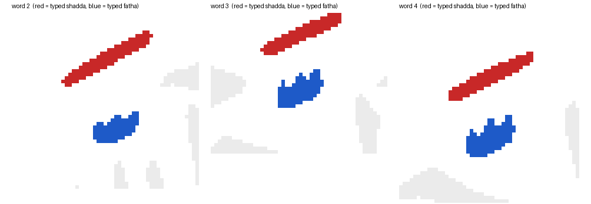

   The check cannot see it is wrong. The word is clean and the library has no opinion, so those types are marked *sure*. This is what a page of review is for, and why the first confirmed page matters: once these six marks are typed correctly by a person, the library knows a fatha from a shadda, and the shape cost breaks the tie on every page after it.

7. **`_shown`** keeps, compactly, the draft as its reviewer will first see it: for each blob its role, its type, whether the text set the type (`by_text`), whether it has a text lock, whether it asks for a look (`look`), and each word's edges. It is stored beside the prediction record, so that a report can say afterwards what the reviewer corrected. For line 2, blob 14 (the alef that the search promoted) is `{'role': 'body', 'subtype': '', 'by_text': False, 'text_lock': False, 'look': True}` (it asks for a look because of `search-override`), and blob 8 is `{'role': 'mark', 'subtype': 'wasla', 'by_text': True, 'text_lock': False, 'look': False}`.

8. **`_frozen_record`** runs the frozen engine (the older one, which works on the cropped line) over the same span, in page coordinates. It is the third reading that the evaluation puts side by side: *frozen*, *canonical* (the prediction record), *calibrated* (with the library's prices) and *confirmed*. A failure here is caught and never costs the reviewer their page.

9. **Store the page.** After one more cancel check:

```python
with transaction.atomic():
    review, _ = CalibrationReview.objects.select_for_update().get_or_create(mushaf=mushaf, page_number=page)
    if review.revision != expected_revision:
        _refuse("stale_revision")
    review.revision += 1
    document["processed_revision"] = review.revision
    review.payload = document
    review.save(update_fields=["revision", "payload", "updated_at"])
    CalibrationRevision.objects.create(
        review=review,
        number=review.revision,
        kind=CalibrationRevisionKind.PROCESSED,
        payload={**prediction, "frozen": frozen, "shown": shown},
    )
    activity.emit(mushaf, ActivityTypeChoices.CALIBRATION_PROCESSED, {...}, actor=user)
return True
```

   Two different things are stored here, and the difference matters for everything after:

   - `review.payload` is the **draft**: the document as the reviewer will edit it (`document["processed_revision"]` ties it to the prediction). It is overwritten by every save.
   - The `CalibrationRevision` of kind `processed` is the **prediction record**: immutable, with the engine's own reading plus the `frozen` and `shown` records.

   `expected_revision` is the optimistic check: it was read when the job started (`0` here, since there was no review), and if the review changed meanwhile, the job ends in error instead of overwriting. For page 1, after this, `review.revision` is `1`, `confirmed_revision` is `None`, and the revisions are `[(1, 'processed')]`.

10. **The job settles.** `process_page` returns `True` to `run` in `start_page`, which calls `jobs.settle(job.id, COMPLETED, pages_saved=1)`. `settle` is one `UPDATE`: `state = completed`, `phase = "finished"`, `current_page = None`, `ended_at = now`, `pages_saved = 1`. If `process_page` had returned `False` (cancelled before it stored anything) the state would be `cancelled` with `pages_saved = 0`, and if it had raised, `_execute` would settle the job as `error` with the message. The cancel flag is the `cancel_requested` column of the job row, read fresh before each line and before the save, so a request made in another process arrives.

11. **What the browser does.** The editor has been polling `GET /api/mushafs/{id}/calibration/job` every second (`useCalibrationJob`: its `refetchInterval` is 1000 ms while the job is running, and `false` once it settles). When the job is settled, an effect announces it once: it invalidates the `pages` query (the rail of pages) and the `page` query, and shows the "page processed" toast. The `page` query refetches `GET /pages/{n}/calibration`, which is `page_document`: the draft, plus `revision`, `confirmed_revision`, `processed`, the settings, the image URLs of every line, and two stale flags (`stale` when a snapshot no longer describes its line, `context_stale` when a neighbouring line changed). The editor builds its `lines` from it and opens.

    About 500 ms after the page opens, the editor also asks for type hints (`POST .../calibration/types`, `type_suggestions`), for every mark that is still untyped. On page 1 there is nothing to ask about, since the text typed all 182. This is explained on page 2.

#### Save draft

The reviewer looks at the page, corrects what is wrong and presses save. For page 1 the obvious correction is the three fatha and shadda pairs of line 2: blob 3 is a fatha, blob 18 a shadda, blob 1 a fatha, blob 10 a shadda, blob 6 a fatha and blob 15 a shadda.

`saveMutation` sends `PUT /pages/1/calibration` with the *decisions* only, through `draftOf`: the `revision` the edits were made on, a `request_id`, and for every line every blob's `id`, `role`, `explicit`, `ownership_explicit`, `subtype`, `subtype_explicit`, `exception`, `allocations` and `erased`. The engine's verdicts (a line's status, a blob's `attention` and `decision_source`) are never sent: a verdict belongs to a reading, not to a decision.

On the server, `save` (without `confirm`) does the following:

1. It locks the `Page` row and then the `CalibrationReview` row (`select_for_update`), always in this order, so that two saves cannot deadlock. A page that was never processed is refused (`not_processed`).
2. **Idempotency.** The `request_id` is looked up in the draft's `request` and in the revisions. If this very request already landed (a retry after a lost response), the current state is returned and nothing is applied twice; if a *different* request reuses the id, it is refused (`request_reused`).
3. `_apply_edits` applies the edits to a copy of the stored draft, and validates them, never trusting them:
   - `revision` must be the review's current one (`stale_revision`), and every line's snapshot must still describe its line (`stale_source`);
   - the lines and blobs sent must be exactly the draft's, and `_merge_blob` checks every blob: a text role, a known exception, allocations that name words of the span, a shared body only across consecutive words of one aya, 0 to 8 PAWs, no PAWs on a mark;
   - a **decision** is only what the client says is one. A role that merely differs from the stored one is not (undoing an accepted preview sends back the old reading, and that must not become a hard lock nobody set);
   - a type typed by a person (`subtype_explicit = True`) replaces the text's, and removes its `subtype_source`;
   - for every blob whose decision fields changed (`role`, `explicit`, `allocations`, `ownership_explicit`, `erased`), the ayat it belonged to before and after are added to `pending_ayas`;
   - every word's box is recomputed from the ink it now has (`_box_words`).
4. Then `review.revision += 1`, `document["request"] = {id, hash}`, `review.payload = document`, and an activity row. **No `CalibrationRevision` is created**: a plain save only updates the draft. Only a confirmation is a source of examples.

For page 1: the draft goes to revision `2`, `confirmed_revision` stays `None`, and blob 3 becomes `{'role': 'mark', 'subtype': 'fatha', 'subtype_explicit': True, 'decision_source': 'search', ...}` with its `subtype_source` removed. `pending_ayas` stays `[]`, because a type is not one of the decision fields: the reading does not depend on it, so there is nothing to align again. Sending the same `request_id` again returns revision `2` without applying anything.

**Preview and accept, where `affected_ayas` appears.** Had the reviewer decided something that *does* change the reading (for example deciding the role of blob 8, which sets its `explicit`), `pending_ayas` would be `['1:1']`. The editor then offers *Preview*: `POST .../calibration/preview` calls `preview`, which applies the edits and runs

```python
align_document(mushaf, edited, affected_ayas=set(edited["pending_ayas"]), calibration_locks=True)
```

and stores nothing. The page is still read whole, because the search needs the neighbouring lines, but only the ayat in `pending_ayas` (and any aya whose ink the new reading passes to or from them, `_changed_ayas`) take the new reading; the rest keeps what the draft had. *Accept and save* sends the same draft with `realign: true`, and `save` aligns it the same way and stores the result, so the stored verdicts and flags are the previewed ones. If `pending_ayas` is empty, `align_document` returns the copy at once (`affected_ayas == set()`).

The edits come back to the engine as constraints, through `_constrain`. The sources of constraints, and what the search does with each, are:

| source | where it lives in the blob | what `_constrain` sets on the engine's blob |
| --- | --- | --- |
| a person set the role | `explicit`, `role` | `locked_role = role`, `lock_source = "human"` |
| a person gave a body to words | `ownership_explicit`, `allocations` | `assigned_word_id`, `paw_count`, `locked_role = "body"`, `lock_source = "human"` |
| the text | `text_role`, `text_word` | `locked_role = text_role`, `lock_source = "calibration"` (provisional) |
| the library | `proposed_role`, `proposal["confidence"]` | `library_role`, `library_confidence`: a price, not a lock |
| a person erased the blob | `erased` | taken off the ink before the search (`_without`) |

| on the engine's blob | effect in the search |
| --- | --- |
| `locked_role = "mark"` | the "spend it as a body" branch is never made |
| `locked_role = "body"` | the "leave it out as a mark" branch is never made |
| `assigned_word_id = w` | it can be spent only while the open word is word `w` |
| `paw_count = n` | spending it takes `n` pieces instead of 1 |
| `library_role` | its two prices are replaced (explained on page 2) |

A person's role beats the text's (an `if` and an `elif` in `_constrain`). A text lock is *provisional*: if an aya cannot be read with it (no reading closes a word, or none reaches the ornament), `commit` releases the provisional locks of that aya, reads it again, and flags each released blob `released-lock`. A person's lock is never released: if it makes an aya unreadable, the aya is reported as a `constraint-conflict` instead. Words that a person said share one blob are read as one unit (`_fused_units`), their PAWs and dots added up, and split again afterwards.

#### Confirm the page

When the page is right, the reviewer confirms it. `confirmMutation` sends `POST .../calibration/confirm`, which calls the same `save`, with `confirm=True`. Everything above still happens, and then:

1. **The exceptions.** `exceptions(document)` lists what a confirmation must acknowledge: a flagged blob (`exception` set), a word whose PAWs do not add up (`paw-count`), and a line the last alignment left `partial` or `unresolved`. If there are any and the client did not send `acknowledge_exceptions`, the confirmation is refused (`exceptions`, 422) and the editor asks. Page 1 has none.
2. **The product.** `word_coordinates.replace_page_words` writes the page's words, whole lines at a time, in one transaction: it deletes the `LineWord` rows of those lines and creates one row per word with `word_id`, `position` (the index in the line, which is the order the mushaf reads them in), `start_x` (the right edge, the larger) and `end_x` (the left edge). Page 1 has 29 of them, and the first four rows, of line 2, are `(1, 0, 1311, 1155)`, `(2, 1, 1161, 1098)`, `(3, 2, 1099, 987)` and `(4, 3, 983, 853)` as `(word_id, position, start_x, end_x)`. These rows, and not the draft, are what the exports read.
3. **The immutable approval.** `review.revision += 1`, `review.confirmed_revision = review.revision`, and a `CalibrationRevision` of kind `confirmed` is created with `_record(document)` (without the context rows, because they were never approved), `request_hash`, and `acknowledged` (the exceptions the reviewer acknowledged). Its payload's `processed_revision` points back at the prediction record, which is how the evaluation later compares what the engine said with what was confirmed.

For page 1 the revisions are now `[(1, 'processed'), (3, 'confirmed')]` (revision 2 was the draft save), `review.revision` is `3` and `confirmed_revision` is `3`. After the response, the editor invalidates the `evaluation` and `readiness` queries: one more page is evidence.

A confirmation is the only way to teach the engine. From now on, every blob of page 1 is an example.

#### The second page, with page 1 as the library

> The numbers below come from a dry run: page 1 confirmed after the three fatha and shadda pairs were corrected, and page 2 processed from it, all inside a transaction that was rolled back. Nothing was stored.

Page 1, in two sentences: the library was empty and nobody had decided anything, so the engine read the page alone (the prediction record), the text typed the marks, and the draft was that reading. The page is now confirmed, and everything that was inert then starts to work.

Page 2 is the first page of Al-Baqarah: its span is `(2, 1)` to `(2, 5)`, over 6 text lines (3 to 8) and 36 words. `start_page` and the job are as before (`expected = 0`: it was never processed). `process_page(mushaf, 2, ...)` starts the same way, and the first difference is in `profile_for`.

##### The profile and the library

`profile_for(mushaf, 2)` asks `_approved(mushaf, 2)` for every confirmed approval *other than the page itself* (a page is never predicted from its own labels, which keeps each prediction record an honest test of the others). It finds page 1's. The profile's identity now lists that revision, so its signature is a new one: a new `CalibrationProfile` row with `pages: [1]`. Page 1's own profile (the empty one) stays.

`_library_of` builds the library from exactly the revisions the profile records, never from "whatever is approved now": a page confirmed again later must not change the examples behind a prediction that was already made.

- `_samples` takes the blobs of the approved revision that may teach (`_eligible`): not ornaments or symbols (that leaves out 14 of page 1's 259 blobs, the ring and the digit of each of the 7 ornaments), not flagged ink, not erased ink, and not a body that stands for other than exactly one PAW. That is **245 examples**: 63 bodies and 182 marks. Each has its descriptor (`features`) from its snapshot, and its type if it is a *typed* mark (a type typed by a person, or set by the text and confirmed).
- `build_library` groups them kind by kind: the bodies are one kind, and each mark type is its own kind (11 types on page 1). Inside a kind, each example, in page order, joins the nearest fingerprint within the `LIMIT` (0.27 for `descriptor32`, a setting of the mushaf) or becomes a new fingerprint. Each group's fingerprint is then re-chosen as its most typical member, and the library keeps every fingerprint and up to 11 of its members. Here that is **64 fingerprints** and 202 kept shapes.
- `can_propose` is true when the library has both bodies and marks. Before that it answers "no examples" to everything.

The library is cached by `(mushaf, signature)`.

##### Every blob gets a proposal

`_blank_row` for page 2's lines now has `library.can_propose`, so, for every text blob, it asks the library (`roles_of`): the nearest kept letter and the nearest kept mark, by the distance between their descriptors; the role is the nearer one, and

```text
confidence = (far - near) / (far + near)
```

says by how much. For blob 27 of line 3, the nearest kept letter is 0.0923 away (page 1, line 6, blob 34) and the nearest kept mark 0.308 away (page 1, line 4, blob 22, a daggerAlif), so the proposal is `body` with a confidence of 0.5388. The row stores `proposed_role` and the whole `proposal` (with the two nearest examples, for the reviewer to look at). Over page 2's 315 text blobs the confidence runs from 0.01 to 0.80 with a median of 0.39, and 261 of them are 0.2 or more, which the engine calls *sure* (`SURE_CONFIDENCE`).

##### The first reading, unchanged

`align_document(mushaf, document, text_locks=False)` is called as on page 1, without `calibration_locks`: the proposals sit on the rows and are ignored. The prediction record is therefore the engine alone again, and all 6 lines come out `exact`. `_place_text_locks` finds no small waw or ya on this page, so `reread` is empty.

##### The second reading

Now `library.examples` is 245, so the second reading happens: `align_document(mushaf, document, calibration_locks=True)`. Two things in `_read` that were off on page 1 are on:

1. **`_constrain` prices the blobs with the library.** For every blob whose `proposed_role` is a text role, `blob.library_role` and `blob.library_confidence` are set. While `library_role` is set, the two prices of the blob are *replaced* (`Blob._against_library`): reading it as the library's role costs 0, and reading it against it costs

   ```python
   round(SURE_PRICE * min(1.0, library_confidence / SURE_CONFIDENCE))   # round(40 * min(1, confidence / 0.2))
   ```

   > SURE_PRICE = 40, SURE_CONFIDENCE = 0.2
   > A sure answer (0.2 or more) costs the whole 40 to overrule, and a weaker one costs in proportion. 40 is dearer than a word that is one PAW short (20), plus the cap for leaving a mark unused (6): so when two PAWs are printed touching, the word is left a piece short and flagged, instead of promoting the nearest mark to make up the count.

   The library is a *price*, not a lock: the search can still go against it, it just pays. That is the difference from the human and text locks of the previous part.

2. **`_short_weights` lowers what a missing PAW costs some words.** Every word pays 20 for a missing PAW, so which word of an aya comes up short, when the ink is short by one, is a tie. The fusion table (`_fusion_table`) breaks it with what the confirmed pages show: for every join between two pieces (the last letter of one, the first of the next), inside a word and across the space between two words, how often it was printed touching, out of how often it was printed. `_touching_joins` finds the touching ones (a body given two PAWs of a word covers the join between them, a body shared by two words covers the join across the space), and `_printed_joins` counts all of them. The chance of a join is `touching / (printed + 1)`, falling back to the letter that ends it when the pair has never touched and was printed fewer than 5 times, and a word's weight is `round(20 - 12 × (the chance that any of its joins touches))`, never below 8.

   Page 1 has no touching join at all (no body with 2 PAWs, none shared), so for its 16 kinds of join inside a word and 17 across a space the chance is 0, and all 36 words of page 2 keep a weight of 20. This starts to matter once a confirmed page shows a ر touching its next piece, for instance.

The second reading changes four blobs of page 2 against the prediction record:

| line | blob | score | first guess | engine alone | the library says | price against it | draft |
| --- | --- | --- | --- | --- | --- | --- | --- |
| 3 | 28 | 0 | mark | mark | body, 0.06 | 12 | body |
| 4 | 54 | 11 | body | body | mark, 0.17 | 34 | mark |
| 5 | 62 | 8 | body | body | mark, 0.26 | 40 | mark |
| 6 | 50 | 10 | body | body | mark, 0.27 | 40 | mark |

The three blobs the library calls marks leave their words one PAW short, since reading them as bodies would cost 34 or 40 against 20: lines 4, 5 and 6 become `scored` (`1 word(s) off-count; 2 equal-cost readings`, and line 4 also `i'jam short`), and `_shortages` lists aya 2:3 (the word ٱلَّذِينَ) and aya 2:4 (إِلَيْكَ), each one PAW short, with `certain: False` because the lines of those ayat had equal-cost readings, which may have put the shortage in a neighbouring word. Whether the library or the engine alone is right on these three is for the reviewer to judge by eye: after one confirmed page, the library is small.

All 315 text blobs end with `decision_source = "calibration"`: each one's final role is the library's proposal, so `_apply_outcome` credits the library. And no blob has an `attention` flag: the engine's doubts (`uncertain`, `search-override`, `ambiguous`) are *answered*, not raised, when the library agrees with the role the blob ended with.

##### The marks' types, with a library that knows types

`_apply_text_types` runs as before, but now `check_rows` has the library's type scores for every mark (`index.type_scores`), so the shape cost of a slot is real, and a text type is *sure* only if the library does not prefer another by more than `SURE_MARGIN` (0.2). The words that fit their text are typed by the text: 116 of page 2's 236 marks. The other words are not clean, for example word 31 lacks a daggerAlif in its ink, word 32 and 38 an ijamDot, and words 41 and 42 have ink left over; 21 of the 36 words are clean. Their marks stay untyped.

When the editor opens the page, `type_suggestions` fills in the rest (`POST .../calibration/types`, after 500 ms, again whenever the typing changes). It builds the index from the library and the marks already typed on this page, and gives every untyped mark a suggestion, from the first of these that has an answer: a dot inside a pause sign, or the sign around one (the sign's type); the text, where it is sure; three loose dots in a triangle (the embraced pause sign); the examples, where they are sure; the text, where it is not sure; the examples, where they are not sure. For page 2: 120 suggestions, 78 from the examples and 42 from the text, 59 of the 120 sure, no doubt on a typed mark, and 1 mark that may be noise (`_noise`: a speck of a few pixels, or a stranger that its word's check has left over). A suggestion changes nothing in the draft: accepting it is what types the mark, and a typed mark is what teaches the next page.

##### What else was waiting for a second page

- **Context rows.** `_approved_rows` returns rows only for pages other than this one whose lines the span reaches. Page 2's span lies inside page 2, so there are none (`context: []`). When an aya crosses a page break, the lines on the other page are read as context, never saved: if that page is confirmed, they come in as *approved rows* (`_as_constraint`: every role a human decision, every allocation a human assignment, so the alignment reads around them), and if it is not, as blank read-only rows.
- **`_carry_decisions`.** When a page is processed again because its sources changed (its lines, a neighbouring line it crosses onto, an erase, a re-captured template), `before` holds the old draft's rows by snapshot id. For a line whose snapshot is unchanged, the blob ids still mean the same pixels, so the reviewer's explicit roles, ownership, exceptions, types and erases are put back, and the page is read once more with them as human locks. A changed line has a new snapshot and starts over. The old revisions stay in the history.
- **Editing a page that has a library.** The preview of a page with a library prices every blob as above, and your decisions are hard constraints on top of that.

| page 1 | page 2 |
| --- | --- |
| library: 0 examples, so no proposals | 245 examples, 64 fingerprints: every text blob has a proposal with a confidence |
| one reading | two: the engine alone (the prediction record), then with the library's prices |
| `_constrain` set nothing | `_constrain` prices every blob against the library |
| `_short_weights`: not used | used, but every weight stays 20 until a confirmed page shows a touching join |
| text types: all 182 marks, tied by position only | 116 of 236 by the text, with the library's shapes breaking ties; 120 more suggested |
| no text locks (no small waw or ya) | none on this page either; they would add a second reading |
| no context rows, no earlier draft | none here either: they appear for an aya that crosses a page, and for a page processed again |
